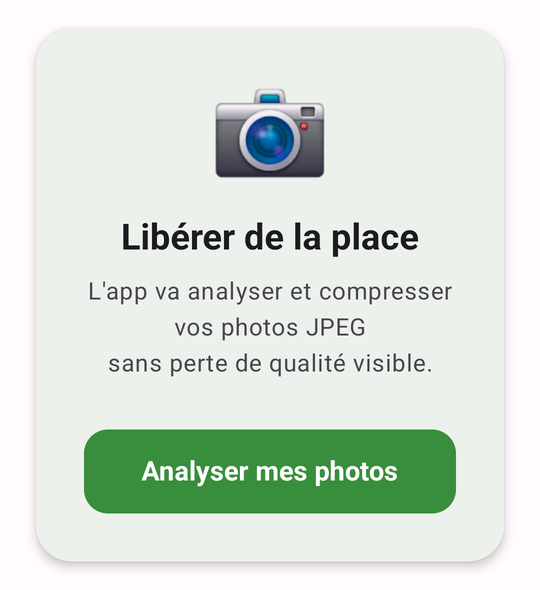
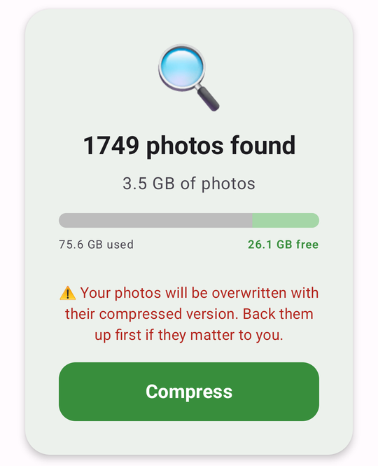

# 📷 Photo Compressor

Phone full? Photo Compressor frees up space by compressing your photos right on the phone.
No cloud, no account: your photos never leave the phone.

## Install

You need an Android 8 phone or newer.

1. On the phone, open the download page: [click here](https://github.com/amandiofr/PhotoCompressor/releases/latest).
2. Under **Assets**, tap the file ending in `.apk`.
3. Open the downloaded file and tap **Install**. If Android or Play Protect asks, allow it.

## Use

1. Open Photo Compressor and tap **Analyser mes photos** (analyse my photos).
   It shows how many photos can be compressed and how much space your phone has left.
2. Tap **Compresser** (compress). Android asks for permission to modify your photos: allow it.
3. At the end, the app shows how much space was freed.

## Good to know

- **There is no undo**: the photos are replaced by their compressed version. The difference can't be seen with the
  naked eye, but if some photos really matter to you, keep a copy elsewhere first.
- The date, place and orientation of each photo are kept.
- Only JPEG photos are compressed: not PNG, HEIC or videos.
- Photos that are already light are left alone.
- With many photos, compression goes on even if you leave the app.

## For developers

How it works, permissions and building: [click here](docs/TECHNICAL.md).
